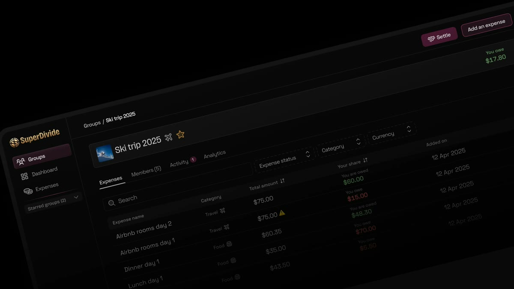
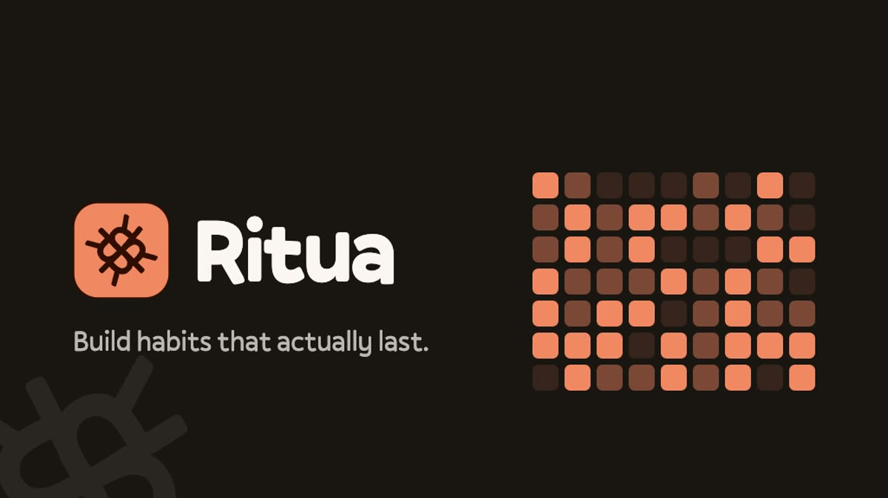
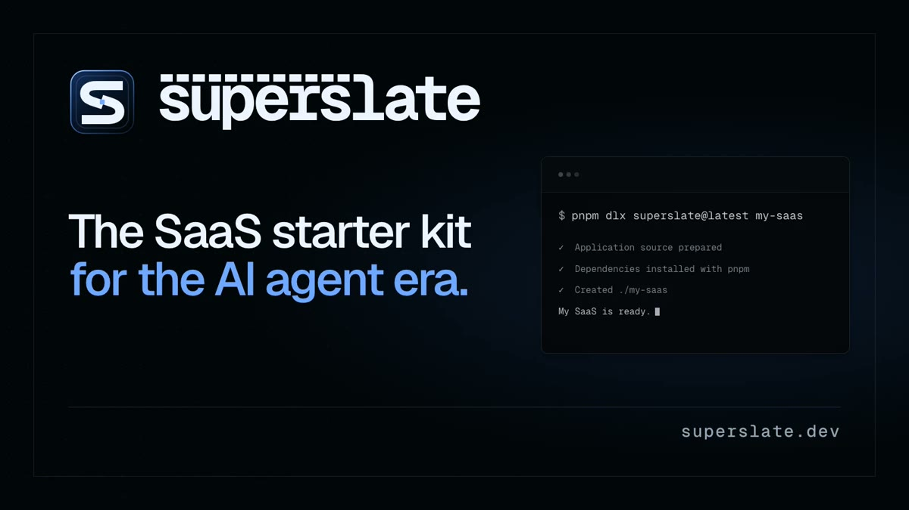
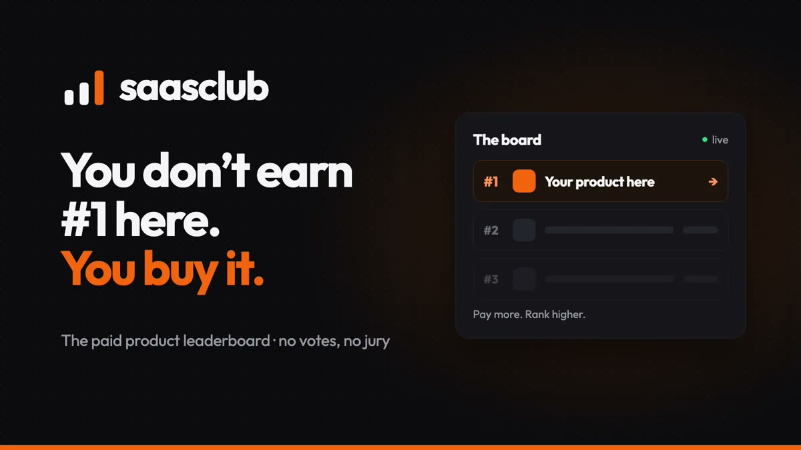
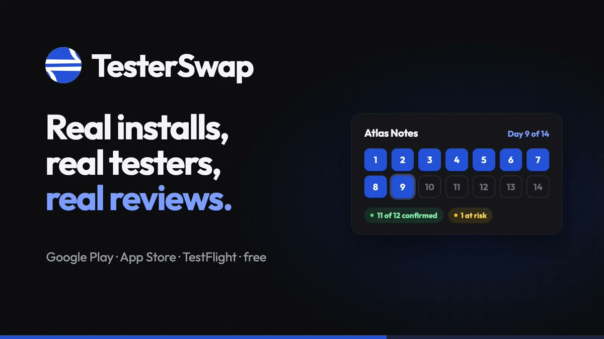

<em>Product engineer based in Bengaluru.</em>

  <a href="https://sohamsarkar.com"><strong>Products</strong></a>
  ·
  <a href="https://sohamsarkar.com/projects"><strong>Projects</strong></a>
  ·
  <a href="https://sohamsarkar.com/resume"><strong>Experience</strong></a>
  ·
  <a href="mailto:sohamsarkar.work@gmail.com"><strong>Contact</strong></a>

---

## Products

<table width="100%">
  <tr>
    <td width="50%" valign="top">
      
      <h3>SuperDivide</h3>
      
<strong>Shared expenses, settled.</strong> Create, manage and settle shared expenses without the hassle.

      <a href="https://superdivide.com"><strong>superdivide.com →</strong></a>
    </td>
    <td width="50%" valign="top">
      
      <h3>Ritua</h3>
      
<strong>Build habits that actually last.</strong> A free habit tracker with streaks, habit scores and planned rest days.

      <a href="https://getritua.com"><strong>getritua.com →</strong></a>
    </td>
  </tr>
  <tr>
    <td width="50%" valign="top">
      
      <h3>superslate</h3>
      
<strong>The SaaS boilerplate built for the agent era.</strong> Source-owned TypeScript foundation in React + Hono, TanStack Start and Expo editions.

      <a href="https://superslate.dev"><strong>superslate.dev →</strong></a>
    </td>
    <td width="50%" valign="top">
      
      <h3>saasclub</h3>
      
<strong>You don't earn #1 here. You buy it.</strong> The paid product leaderboard: whatever you pay is your rank.

      <a href="https://saasclub.app"><strong>saasclub.app →</strong></a>
    </td>
  </tr>
  <tr>
    <td width="50%" valign="top">
      
      <h3>TesterSwap</h3>
      
<strong>Real installs, real testers, real reviews.</strong> Developers test each other's apps and clear Google Play's 14-day closed test together.

      <a href="https://testerswap.com"><strong>testerswap.com →</strong></a>
    </td>
    <td width="50%" valign="top">
      
      <h3>CTC in Hand</h3>
      
<strong>Your CTC, as the money that lands each month.</strong> In-hand salary calculator for India, new vs old tax regime side by side.

      <a href="https://ctcinhand.in"><strong>ctcinhand.in →</strong></a>
    </td>
  </tr>
</table>

  <a href="https://sohamsarkar.com"><strong>All products on sohamsarkar.com →</strong></a>

## Selected work

| Project | What it does | Explore |
|---|---|---|
| **Country Finder** | Search, filter, and explore detailed information about countries around the world. | [Live app](https://country.sohamsarkar.com) · [Source](https://github.com/sohhamm/country-finder) |
| **Password Generator** | Generate secure, customizable passwords with real-time strength feedback. | [Live app](https://passwordxgenerator.vercel.app) · [Source](https://github.com/sohhamm/password-generator) |
| **Pokédex** | Explore Pokémon information, stats, and details through a searchable interface. | [Live app](https://pokedex.sohamsarkar.com) · [Source](https://github.com/sohhamm/pokemon-react) |
| **Temporary Chat Enforcer** | Privacy-first browser extension that automatically enables temporary chat across ChatGPT, Claude, and Gemini. | [Source](https://github.com/sohhamm/temporary-chat-enforcer) |
| **Charizard** | Open-source React component library with 50+ accessible, typed, production-ready components. | [Showcase](https://ui.zenadmin.co) · [Source](https://github.com/Usehybrid/charizard) |

  <a href="https://sohamsarkar.com/projects"><strong>Explore more projects →</strong></a>

### Let’s connect

Building something interesting, looking for an experienced product engineer, or just want to compare notes?

<a href="https://sohamsarkar.com">Website</a>
·
<a href="https://linkedin.com/in/sohhamm">LinkedIn</a>
·
<a href="https://twitter.com/sohamsarkartech">X / Twitter</a>
·
<a href="mailto:sohamsarkar.work@gmail.com">Email</a>

